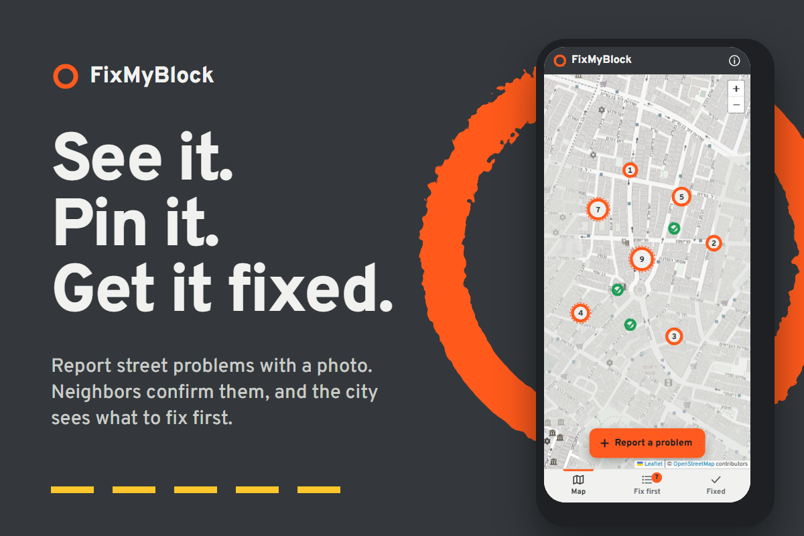

# FixMyBlock

**See it. Pin it. Get it fixed.**

FixMyBlock is a web app for reporting problems in your neighborhood, like a broken
streetlight, a pothole or a leaking pipe. You add a photo, pick what's wrong and put a pin
on the map. Neighbors who saw the same problem tap **I saw it too**, so the most urgent
problems rise to the top of a **Fix first** list that a city crew can work from.



Built for the [Next Founders Hackathon](https://next-founders.devpost.com/) (2026).

## What it does

- **Report a problem** with a category, a photo and a location. Move the map so the orange
  ring sits on the problem, or tap **Use my location**.
- **See everything on one map.** Every report is a spray-paint ring, like the marks city
  crews paint around a pothole. The more neighbors saw it, the bigger the ring.
- **I saw it too.** One tap confirms a problem (one vote per device, and you can take it back).
- **Fix first** ranks the open problems by urgency:
  `urgency = 2 × neighbors who saw it + 3 × danger (1–3) + days waiting (up to 30)`
- **Share with city** opens the phone's share menu (email, WhatsApp…) with the details,
  a map link and the photo. On computers it copies the text instead.
- **Download list for the city (CSV)** exports the ranked list for Excel or Google Sheets.
- **Mark fixed** turns the ring green. The **Fixed** tab shows what got better and how many
  days each fix took. Mistakes can be undone or reopened.

The app starts with 10 sample reports in a public area of central Tel Aviv, so there is
something to see right away. They use drawn pictures, not real photos. You can bring them
back any time with **About (i) → Reset demo data**.

## How to run it

It is plain HTML, CSS and JavaScript. There is nothing to install and no API key.

**Easiest:** double-click `index.html`. It opens in your browser. You need an internet
connection for the map pictures and the font.

**With a local server** (recommended, so "Use my location" works in every browser):

```bash
python -m http.server 8000
```

Then open <http://localhost:8000>.

**On your phone:** put the folder on GitHub Pages (Settings → Pages → Deploy from branch →
`main` / root) and open `https://<your-user>.github.io/fixmyblock/`.

## How it's built

| File | What it does |
|---|---|
| `index.html` | The page: top bar, map, lists, bottom tabs and the three sheets (report, details, about) |
| `css/style.css` | All the design. Colors are named after the street: sidewalk, asphalt, paint, road line |
| `js/categories.js` | The six kinds of problems, their danger level and icons |
| `js/store.js` | The data layer: save, load, vote, mark fixed, the urgency score and the CSV export |
| `js/photo.js` | Shrinks phone photos to at most 900 px (about 100 KB) before saving |
| `js/map.js` | The Leaflet map with OpenStreetMap tiles and the spray-paint rings |
| `js/app.js` | Connects everything to the buttons and screens |
| `DESIGN.md` | The design idea, colors and type |

- **Map:** [Leaflet](https://leafletjs.com/) 1.9.4 with [OpenStreetMap](https://www.openstreetmap.org/) tiles. Free, no key.
- **Storage:** `localStorage` in the browser. This is a demo: reports stay on the device
  where they were made.
- **Typeface:** [Overpass](https://fonts.google.com/specimen/Overpass), based on Highway
  Gothic, the typeface on US road signs.
- **No framework and no build step**, so every line is easy to read and change.

### Scaling up

All reading and writing goes through `js/store.js`. To share reports between everyone in a
city, only that file changes: the same functions (`add`, `toggleVote`, `markFixed`) would
call a hosted database (for example Supabase or Firebase) instead of `localStorage`, and
photos would go to file storage instead of being saved inside the report. With many reports,
the map would load only the reports inside the visible area and group nearby rings together.

## Limits of the demo

- Reports are saved only in this browser. Other people can't see them yet.
- Anyone can tap **Mark fixed**. A real version would ask a city account or two neighbors
  to confirm.
- Browser storage holds about 5 MB, which is roughly 30–50 reports with photos.

## Credits

- Built with help from **Claude** (an AI assistant by Anthropic), which helped write the code
  and explained how it works.
- Map data © [OpenStreetMap](https://www.openstreetmap.org/copyright) contributors.
- Map library: [Leaflet](https://leafletjs.com/) (BSD-2-Clause).
- Font: [Overpass](https://fonts.google.com/specimen/Overpass) (SIL Open Font License).

## License

[MIT](LICENSE)
